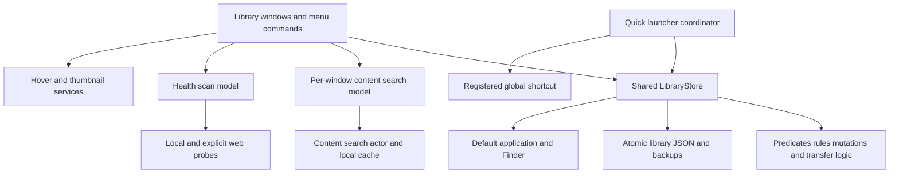

# Switchboard Functional and Technical Specification

Switchboard is a local macOS reference library for files, folders, applications, and web links. It provides organization, search, previews, opening, a global launcher, and library maintenance without relocating the referenced content. This specification describes the implemented behavior and the contracts needed to reproduce it in another language or framework.

Baseline: November 6, 2026; repository HEAD `82861102c3ea9e629852d93b80c04d96c08b750d` plus the current uncommitted working tree, including saved view state, click interaction changes, and Minimal layout ordering. The build script defaults to app version 1.1.0, build 1. Behavior below describes the source at this baseline; the implementation plans are historical design context.

## Contents

1. [Product scope](#product-scope)
2. [Runtime and architecture](#runtime-and-architecture)
3. [Domain model and serialization](#domain-model-and-serialization)
4. [Library window and commands](#library-window-and-commands)
5. [Entry workflows](#entry-workflows)
6. [Collections and tags](#collections-and-tags)
7. [Filtering and smart collections](#filtering-and-smart-collections)
8. [Document content search](#document-content-search)
9. [Display and interaction](#display-and-interaction)
10. [Minimal layout and icon bloom](#minimal-layout-and-icon-bloom)
11. [Quick launcher](#quick-launcher)
12. [Organization rules](#organization-rules)
13. [Transactions and Undo](#transactions-and-undo)
14. [Persistence and restoration](#persistence-and-restoration)
15. [Import and export](#import-and-export)
16. [Backups and recovery](#backups-and-recovery)
17. [Library health](#library-health)
18. [Privacy and platform boundaries](#privacy-and-platform-boundaries)
19. [Build and distribution](#build-and-distribution)
20. [Porting design](#porting-design)
21. [Acceptance and verification](#acceptance-and-verification)
22. [Source map](#source-map)

## Product scope

The primary user maintains a personal catalog of useful local resources and URLs, then finds and opens those resources through a library window or a shortcut accessible from other applications.

The application supports:

- File, folder, and URL references with custom display names, notes, tags, favorite status, and one optional physical collection.
- Nested physical collections, saved smart collections, multiple simultaneous tag filters, and metadata or document text search.
- Seven normal display formats and an independent Minimal icon arrangement.
- Individual and bulk organization, conflict-aware Undo/Redo, and ordered automation rules.
- A global quick launcher and default-application/Finder integration.
- Local reference checks, explicit web checks, duplicate review, reference repair, import/export, and local backups.

Organization changes affect the catalog. Renaming an entry does not rename a file. Moving an entry between collections does not move a file. Removing an entry does not delete its original content. A folder reference is one entry; adding it does not recursively catalog its children. An application bundle is represented using the existing local entry kinds rather than a separate application kind.

There is no account system, server, collaboration, cloud synchronization, managed copy of documents, OCR, web-page indexing, automatic duplicate merging, or external plugin system. Network operations are page-title lookup when Add URL opens and web checks when explicitly requested; opening a URL delegates to the default browser. Document previews also rely on platform services, discussed below.

## Runtime and architecture

### Framework baseline

| Component | Implementation and role |
| --- | --- |
| Language and package | Swift; Swift Package Manager manifest with tools version 6.0 |
| Supported OS | macOS 14.4 or later |
| Build toolchain | Contributor setup specifies Xcode 16.4 or a newer compatible installation; release workflow selects Xcode 16.4 |
| UI | SwiftUI scenes, views, split navigation, tables, lists, inspector, menus, sheets, and bindings |
| Native integration | AppKit windows/panels, file dialogs, workspace opening, Finder reveal, pasteboard, fonts, events, and UndoManager |
| Change propagation | Combine and `ObservableObject` with published state |
| Async work | Swift concurrency: main actor, actors, tasks, detached utility tasks, cancellation, task groups |
| Storage and networking | Foundation Codable/JSON, FileManager, UserDefaults, URLSession |
| Document services | PDFKit for PDF text; QuickLookThumbnailing for previews; UniformTypeIdentifiers for file types and private drag data |
| Native file checks | Darwin file flags and I/O policy for detecting and avoiding materialization of cloud placeholders during content search |
| Hashing and text encoding | CryptoKit SHA-256; CoreFoundation charset conversion |
| Global shortcut | Carbon registered hot keys and symbolic system shortcut inspection |
| Tests | XCTest, with SwiftUI/AppKit integration tests and mocked network services |
| Third-party dependencies | None declared in Package.swift |

`ViewState<Value>` is an alias for `SwiftUI.State<Value>`. It avoids a conflicting State macro in the macOS 27 SDK when standalone Command Line Tools lack that macro's compiler plugin. A port needs ordinary local reactive view state, not a special state-management mechanism.

### Ownership and boundaries

`SwitchboardApp` constructs one `LibraryStore` and one `QuickLauncherCoordinator`. Every library window observes the same store and therefore shares entries, organization, normal display settings, errors, and library Undo history. The application continues running after the last library window closes, keeping the launcher available until Quit.

Each `ContentView` owns a `LibraryWindowState` and a `ContentSearchModel`. Window state includes scope, query, selection, inspector/sidebar visibility, tag filters, and transient dialogs. The values are independent in memory, but persisted preferences use shared keys: newly opened windows initialize from the most recently saved values rather than from separately identified window records.

Pure domain logic handles filtering, predicates, rule evaluation, import merging, layout calculations, and mutation checks. Native UI and services handle interaction, filesystem access, previews, networking, and window activation. There is no database or web API. Most catalog operations work on in-memory arrays and write the complete library JSON.



### Async publication contract

Catalog mutation runs on the main actor. Expensive file extraction and local health checks move to utility tasks. Content search and health scans publish incremental results, reject results from older generations, and cancel superseded work. A port must preserve that isolation: a late response for an old query or an edited/deleted entry must never overwrite current results.

## Domain model and serialization

### Entry

| Field | Type | Meaning and initial value |
| --- | --- | --- |
| `id` | UUID | Stable identity; generated for a new reference |
| `name` | String | User-visible display name |
| `location` | String | Absolute local path or URL string |
| `kind` | `file`, `folder`, `url` | Determines opening, preview, editing, and search behavior |
| `notes` | String | Free text, initially empty |
| `tags` | String array | Canonical tag names, initially empty; deliberately not tag UUIDs |
| `collectionID` | Optional UUID | At most one physical collection |
| `favorite` | Boolean | Initially false |
| `added` | Date | Creation timestamp |
| `bookmark` | Optional binary data | Native macOS file reference, normally absent for URLs |

For URLs, `url` parses `location` and the compact subtitle is its host. For local entries, `url` constructs a file URL and the subtitle is the parent directory. Entry identity is independent of its address; repair and editing preserve the UUID.

### Organization objects

| Object | Fields and behavior |
| --- | --- |
| `LibraryCollection` | UUID `id`, `name`, optional `parentID`, optional SF Symbol `icon`, optional `palette`; default symbol `folder.fill` |
| `LibraryTag` | UUID `id`, `name`, optional `icon`, optional `palette`; default symbol `tag.fill` |
| `SavedFilter` | UUID `id`, `name`, `criteria`, optional `icon`, optional `palette`, optional preferred `sort`; scope is `smart:` plus UUID |
| `TagConstraint` | Set of tag UUIDs plus `any` or `all` match mode |
| `OrganizationRule` | UUID, unique name, enabled flag, trigger, predicate, extra string conditions, ordered actions, stop flag |

Collections form a forest with optional parent references. Paths shown in menus join ancestor names with ` / `. Tags have identity and appearance, but membership on entries uses names; rename must update all memberships while preserving tag UUIDs used by predicates and rules.

### Library root

`LibraryData` stores `entries`, `collections`, `tags`, `savedFilters`, `rules`, `view`, `configurations`, `sort`, and `appearance`.

Defaults for a newly created library are empty arrays, `mediumCards`, an empty configuration dictionary, `name` sorting, and `system` appearance. Configuration dictionary keys are `LibraryView` raw strings. One root object contains the entire catalog and normal display preferences.

### Predicate

`EntryPredicate` contains:

- `queries`: string array, initially `[""]`; each query must match metadata.
- Optional `kind`, optional `favorite`, and optional `collectionID`.
- `fileExtension`: empty means unrestricted.
- `tagIDs`: UUID set with `tagMatch`, initially `any`.
- `additionalTags`: additional independently evaluated tag groups.
- `added`: `anytime`, `today`, `thisWeek`, `lastSevenDays`, `lastThirtyDays`, or `range`.
- `startDate` and `endDate`: timestamps used for explicit ranges.

All nonempty criteria combine with AND. Empty tag groups impose no condition. Optional criteria distinguish unrestricted from an explicit false value.

### Serialization compatibility

All three JSON forms use Swift Codable defaults unless an export explicitly changes formatting:

- UUIDs encode as strings; raw enums encode using their exact raw names.
- Dates encode as numeric seconds since January 1, 2001 UTC, not Unix seconds or ISO 8601 strings. Unix time equals this number plus 978307200.
- Data encodes as a Base64 string. Optional absent values are normally omitted.
- Sets encode as arrays with no contractual ordering. Readers must treat them as sets.
- Synthesized enum encoding is used for associated-value organization actions. For example, `favorite(true)` is represented as `{"favorite":{"_0":true}}`; `addTag(id)` uses the same nested form with a UUID. Test fixtures should establish optional collection payload handling before implementing a compatible writer.
- Unknown raw enum values fail decoding. Unknown object fields can be ignored by Codable.

The internal library has no schemaVersion. Portable libraries and backup envelopes each have `schemaVersion: 1`; these are different document structures.

Backward compatibility is selective: `LibraryData` supplies empty arrays when `tags`, `savedFilters`, or `rules` are absent; collection/tag optional appearance fields and missing `thumbnailSize` also support older data. Other nonoptional decoded fields are generally required. Swift property initializers are not blanket decoding defaults. A port must distinguish initialization defaults from missing-field compatibility.

Illustrative minimal internal library:

```json
{
  "entries": [],
  "collections": [],
  "tags": [],
  "savedFilters": [],
  "rules": [],
  "view": "mediumCards",
  "configurations": {},
  "sort": "name",
  "appearance": "system"
}
```

### Integrity checks

Import/export/backup validation rejects duplicate UUIDs within each entity type, dangling entry collection references, dangling collection parents, collection cycles, blank entry names, empty locations, invalid/extreme added timestamps, invalid tag names, and case-insensitive duplicate tag names. Timestamps must be finite with absolute Unix-second value below 253402300800.

These checks do not require files to exist. Missing smart-collection and rule references use fail-closed behavior rather than making the whole library invalid. Startup decodes and normalizes tags; it does not perform the entire transfer validator. Maintain these distinctions when migrating existing data.

## Library window and commands

The normal window contains a sidebar, main content region, toolbar/search, optional details inspector, and status areas. Default size is 1250 by 790 points, with a minimum 900 by approximately 106.67 points. Sidebar widths are 185–300, ideal 215; inspector widths are 250–360, ideal 285.

The sidebar presents All entries, Favorites, kinds, physical collections with full paths, smart collections, and tag checkboxes. Counts for physical collections are direct membership counts, not descendant-inclusive result counts. Tag counts reflect the stored tag membership. Manager shortcuts appear within the relevant sidebar sections.

| Menu | Functional commands |
| --- | --- |
| Application | Quick Launcher Settings, Command-comma |
| File | Library Health; Import, Export, and Backups; Quick Launcher; Add Files and Folders, Command-O; Add URL; Manage Collections; Manage Tags |
| Edit | Routed Undo, Command-Z; Redo, Command-Shift-Z; Search Library, Command-F; Clear Search |
| View | Native sidebar controls; Minimal; Minimal Icon Bloom; Minimal Layout rows/reset; details panel; display format; view configuration; appearance; scope filter; Search In; smart collections; collections; tags; rules; bulk organization; sort; hierarchical collections; collection-name visibility; single/double-click behavior |

Commands that require a library window are disabled without a focused window. Quick Launcher and its settings remain available. Focused-scene state directs commands to the appropriate library window; the store remains shared.

The toolbar provides adding, display format, content-search mode, smart collections, physical collections, tags, bulk organization, configuration, inspector, and search. Menus retain access when Minimal hides the toolbar.

An empty unfiltered library invites adding or dropping entries. An empty filtered result suggests changing criteria and offers appropriate clearing/editing actions. When child collections exist but collection navigation is hidden, a specific empty state offers Show Collection Names.

## Entry workflows

### Add local references

1. Invoke the native multi-select picker or drop file/folder URLs into the content area.
2. Standardize each local path. Skip any address exactly equal to an existing candidate entry's location.
3. Inspect directory metadata: directories become `folder`, other local URLs become `file`.
4. Use the final path component as the initial name. Attempt to generate bookmark data; bookmark failure does not prevent the entry from being staged.
5. Assign the currently selected physical collection, if any. A kind/favorites/smart scope does not imply organization assignments.
6. Apply enabled addition rules to newly created UUIDs once.
7. Persist the candidate and publish only on success.

The drop handler accepts file URLs or web URLs accepted by the web validator. It returns drop acceptance based on valid input, not the count of references actually inserted. No recursive scanning occurs.

### Add URLs

Trim surrounding whitespace. If the input contains no `://`, prepend `https://`. Accept only HTTP/HTTPS with a nonempty host containing no space. This is intentionally a lightweight validator, not a public-domain or DNS-reachability check. Explicit localhost/private addresses can be represented.

The dialog includes editable URL and optional display name. Invalid URL input disables Add. A blank supplied name falls back to the host. Duplicate detection uses the resulting URL's exact absolute string; it returns/selects the existing entry rather than creating a new one. Existing entries do not receive addition rules again.

Opening the dialog checks the clipboard's URL or string representation for one web address. Clipboard detection rejects internal whitespace and requires a plausible host: a dot, localhost, colon, or an explicitly supplied scheme. If detected, a suggestion appears and title fetching begins. Use Clipboard Details fills the URL/name; Use Clipboard URL remains available when no title is retrieved. Dismiss discards the suggestion. Nothing is inserted until Add URL is pressed.

### Clipboard page-title request

The title service uses an ephemeral URLSession without cookie storage, credentials storage, or URL cache. It requests HTML/XHTML with a 10-second request and 15-second resource timeout, accepts 2xx responses, rejects explicit non-HTML MIME types, and reads at most 1,048,576 bytes. The response charset takes precedence over an early meta charset; fallback decoding uses UTF-8 and Windows CP1252.

The parser removes comments and script/style blocks, reads the first HTML title, decodes supported named/numeric entities, collapses whitespace, and limits the result to 500 characters. It does not render HTML, execute JavaScript, or request page resources. Failure or no title leaves manual entry usable. This service uses normal URLSession redirect behavior, rather than the custom redirect guard used for web health checks.

### Edit and operate on entries

The inspector loads an editable draft for one selected entry. Users can change display name, URL for URL entries, collection, tags, notes, and favorite status. Local paths are shown as selectable read-only text; replacing a local target is a health-repair operation.

Save Details and Return in the name/URL/tag fields save the draft. Collection changes, favorite changes, and tag-menu changes also save current draft values. Names are trimmed and must be nonblank; URL edits pass the same web validator. Tags are comma-separated, trimmed, deduplicated, canonicalized through the catalog, and created as needed. Notes remain free text. URL edits do not perform the add-flow duplicate check.

Context menus expose Open, Show in Finder for local items, Copy Location, favorite toggle, Move to Collection, Remove from Collection, and confirmed Remove from Library. When the clicked entry is part of a multiselection, the bulk menu acts on that selection.

Open resolves a native bookmark when possible and delegates to NSWorkspace/default applications. If the bookmark resolves at a new path or is stale, the app refreshes the stored path/bookmark without adding Undo. Failed bookmark resolution falls back to the stored location. Open failures appear as library errors. Reveal uses Finder selection for local items; Copy Location copies the stored string.

## Collections and tags

### Physical collections

The collection manager adds, renames, changes icon/color, sets a parent, and deletes collections. Editing another selection, Save Changes, or Done saves the previous draft. Names must be nonblank; collection names need not be unique. Available icons include folders, trays, briefcases, homes, books, education, stars, hearts, music, photos, globes, and archives. Colors use the five shared palettes or default.

A collection cannot be its own ancestor. The parent picker excludes the current subtree, and the store independently rejects invalid parents/cycles. An entry belongs to zero or one collection.

Deleting a collection unassigns its direct entries and reparents its immediate subcollections to the deleted collection's parent. It does not delete entries, descendant collections, or source files. Smart criteria referencing the deleted UUID become unavailable; rules referencing it are disabled on commit.

### Tags

Tag names must be unique ignoring case, nonblank after trimming, and contain no comma. Existing entry tags populate the catalog during startup normalization; unused catalog tags remain available. Normalization canonicalizes membership spelling and removes empty/invalid/duplicate memberships.

The manager supports add, rename, icon/color edits, and confirmed deletion. Valid drafts save on selection change or Done; invalid drafts retain the editor and show validation. Rename updates matching membership names in every entry, preserving the tag UUID. Delete removes membership from every entry and removes the catalog tag. Predicates keep their missing UUID references and therefore fail closed; affected rules are disabled.

Sidebar/menu tag selections are UUIDs, resolved to current names for entry matching. Match any uses OR within the selected group; Match all uses AND. Tag filters combine with scope, query, and smart predicates. Clear Tag Filters clears only selected tags.

## Filtering and smart collections

### Ordinary filtering

Scope values are `all`, `favorites`, `file`, `folder`, `url`, a collection UUID string, or `smart:<UUID>`.

| Scope or mode | Visible entry behavior |
| --- | --- |
| Flat All entries | Every entry |
| Flat physical collection | Entries assigned to that collection or any descendant |
| Hierarchical All entries without query/tags | Unassigned entries plus separate navigation for top-level collections |
| Hierarchical physical collection without query/tags | Direct entries plus navigation for immediate child collections |
| Physical collection with a metadata query or selected tags | Collection and descendants, including when hierarchical browsing is enabled |
| Favorites or kind | Matching entries across collections; hierarchical browsing does not restrict these scopes |
| Smart collection | Its predicate over the whole library, followed by current extra filters |

Text search trims the query and performs one localized case-insensitive substring match against any of display name, location, notes, or all tags joined with spaces. It does not tokenize words, interpret operators, or include collection names. An empty query matches every entry. A smart predicate's multiple queries must each match, potentially in different fields.

Sorting is Name using localized standard comparison, Newest using descending added date, or Kind using raw kind strings ascending (`file`, `folder`, `url`) then Name. Equal ordinary names/dates have no explicit UUID tie-breaker. Search suggestions show up to 12 currently matching entries; choosing a suggestion opens it.

### Smart criteria and dates

Smart collections are saved predicates, not containers. New additions made while browsing one are unassigned unless rules assign a collection; they appear only if their metadata matches.

Predicates add kind, extension, favorite, collection-with-descendants, tag groups, and added-date constraints to metadata queries. Extension matching removes surrounding whitespace/dots and compares the location's path extension ignoring case. Every tag group must pass independently. Any missing referenced tag/collection makes the predicate match nothing, even for an `any` group with other valid tags.

Dates use the current calendar/time zone. Today runs from local midnight through but excluding the next midnight. This week uses the calendar's week interval. Last 7/30 days includes today plus the preceding 6/29 calendar days. Explicit ranges include both chosen dates by using an exclusive next-day upper bound. Date arithmetic must respect daylight saving changes rather than assume 86400 seconds per day.

The window reevaluates relative dates on day change, time-zone change, and application activation. Selecting a smart collection with a preferred sort changes the shared normal sort; leaving it does not restore an earlier sort automatically.

The manager supports create, edit, duplicate, delete, icon/color, all predicate fields, preferred sort, and a live matching count. Smart names must be unique ignoring case after trimming. Deleting keeps library entries. Missing references are visible for repair. The menu's Save Current Filters captures current scope, metadata text, tag conditions, and sort; existing smart conditions are combined rather than replaced. It does not save asynchronous document-content search semantics. Selecting a smart collection through its menu clears extra text/tag filters; selecting its sidebar row changes scope while retaining those filters.

## Document content search

Search mode is Metadata, Document contents, or Metadata and contents. A nonempty query activates content search for the latter two modes. Scope, tag constraints, and smart predicates first select candidates. Content-only returns document matches; Both returns the union of metadata and content matches within those candidates. Content queries disable direct-only hierarchical restrictions so descendants can participate.

### Extraction contract

| Input or bound | Implemented behavior |
| --- | --- |
| Eligible entries | Local regular files only; folders/URLs skipped |
| Text extensions | txt, md, markdown, log, json, yaml, yml, toml, csv, tsv, swift, rs, js, ts, html, css, xml |
| Text input bound | 1,048,576 bytes |
| Text decoding | UTF-16 with byte-order mark; otherwise UTF-8 with no NUL bytes |
| PDF input bound | 8,388,608 bytes and at most 200 pages |
| PDF extraction | PDFKit page text; invalid, locked, or textless PDFs skipped; no OCR |
| Extracted text bound | 500,000 Swift characters for text and PDF |
| Filesystem exclusions | Nonlocal mounted volumes and not-downloaded cloud placeholders |
| Read behavior | Recheck sizes, read at most limit plus one, reject growth beyond limit; disable dataless-file materialization for the extraction thread |
| Match semantics | First case-insensitive and diacritic-insensitive substring match |
| Snippet | Up to 70 characters before and 100 after the matching range; line breaks become spaces |

A failed non-downloading I/O policy causes extraction to be skipped. Do not silently download cloud documents in a port. Swift character counts are grapheme-oriented rather than byte counts; reconcile the target language's string indexing.

### Scheduling and cache

Query work debounces for 180 milliseconds. A task group keeps up to four candidate operations in flight; extraction uses detached utility tasks behind the search actor. Results are incremental and have states `matched`, `noMatch`, `unavailable`, or `skipped`. The coverage panel reports progress and reasons for unsearched entries. Snippets highlight the first matching range; tables add a Content match column while content querying.

The cache is `~/Library/Caches/Switchboard/ContentSearch/<entry UUID>.json`, storing a signature and extracted text. The signature is SHA-256 over resolved path, size, modification timestamp, and file resource identifier. Entries are reused only when signatures match; cache hits update file modification time for recency. Individual cache reads are capped at 4 MiB; the default total budget is 20 MiB with oldest-access eviction. Deleted-library IDs are pruned. Cache write failure does not invalidate otherwise successful extraction.

Refresh changes the request version and rechecks file signatures; it does not force rereading a file whose signature is unchanged. Clear Cache changes the generation, removes cache data, clears results, and reruns the request. Activation refreshes active content queries. Restore posts a replacement notification that clears caches. There is no filesystem watcher or Spotlight dependency. Each window owns its own service actor while using the same default cache directory.

## Display and interaction

### Normal formats and configuration

| Format raw name | Layout |
| --- | --- |
| `thumbnails` | Adaptive fixed-size square tiles without text labels, 8-point spacing and 12-point outer padding |
| `smallCards` | Adaptive cards with minimum width 170; content-driven height; 36-point leading icon |
| `mediumCards` | Minimum width 230, minimum height 205, 48-point icon |
| `largeCards` | Minimum width 300, minimum height 250, 60-point icon |
| `compactList` | Native selection list with 30-point icon and 2-point vertical row padding |
| `comfortableList` | Native selection list with 44-point icon and 10-point vertical row padding |
| `table` | Native multiselection table with configurable fields and resizable columns |

Cards use 16-point gaps and 24-point outer padding. Name is always visible outside Thumbnails. Configurable fields are Kind, Location, Tags, Notes, and Date added; default fields are Kind, Location, Tags. Default palette is Ocean, font System, font size 13. Other palettes map to Violet/purple, Forest/green, Amber/orange, and Graphite/gray; Ocean maps to blue.

Each normal format stores its own configuration. Font choices are installed family names, with a 10–24 point slider. Thumbnails instead has a 48–160 point slider in steps of 8, default 80; invalid nonfinite values resolve to 80 and other values are clamped. Reset This View replaces the current format's configuration with defaults. Appearance is shared System/Light/Dark, stored separately from per-format fields.

Table fields have minimum/ideal widths: Name 150/220; Kind 60/75; Location 150/300; Tags 80/130; Notes 100/200; Date added 90/110; active Content match 180/260. Users can resize boundaries, but explicit column-width persistence is not implemented.

### Selection and opening

Double-click opening is the default. In cards/thumbnails, a single click selects; Command-click toggles membership; Shift-click selects the inclusive range from an existing anchor. The configured opening click count selects and opens, except Command/Shift suppress opening. List/table retain native selection behavior and use primary actions for opening; single-click mode explicitly suppresses open on Command/Shift. Keyboard primary actions can open selected list/table entries.

Scope or tag-selection changes clear the window selection, except the launcher reveal flow preserves its explicitly revealed entry. Tag match mode changes clear selection. Validation removes deleted entry/tag IDs. Query changes do not have an explicit selection-clear handler, so hidden selected entries can remain selected. Bulk actions use selected IDs, not only visible rows.

Accessible card/thumbnail interactions expose the name, button trait, and selected state. Their default accessibility action selects and opens only when single-click mode is enabled. Minimal supplies arrow-key navigation and explicit reorder actions. A port should preserve native keyboard/multiselection semantics instead of relying solely on pointer gestures.

### Previews and hover details

Normal cards/lists/tables and thumbnail tiles show a passive hover panel after 450 milliseconds. Exit schedules an 80-millisecond hide delay to avoid flicker between cells. Mouse-down, typing, scrolling, menu tracking, or app deactivation dismisses it. The panel does not take focus or intercept pointer events and is positioned within the screen's visible bounds.

Details include name, favorite, kind, location, collection, tags, notes, date added, and a content match excerpt when available. File panels are 400 points wide; others 320. File previews try a bounded text excerpt first, then Quick Look. Text preview reads at most 16,384 bytes and returns the first 14 lines; empty files get an explicit message. It supports recognized text types and UTF-16 BOM/UTF-8, rejects NUL-bearing binary input, and tolerates a truncated UTF-8 tail. Quick Look hover requests default to 368 by 220 at display scale and support cancellation. Missing previews preserve metadata and show an unavailable state.

Thumbnails prefer native application icons for application bundles. Other files show a file-icon fallback while requesting a Quick Look image at 160 by 160, reused across tile resizing. Folders and URLs use symbols; ordinary card/list/table symbols also recognize application icons. Thumbnail/hover loading is keyed to the entry value, not a continuous external-file watcher.

The hover preview path does not apply all remote/cloud guards used by document content search. Treat preview service behavior and content-search non-download guarantees as separate contracts.

## Minimal layout and icon bloom

Minimal is a shared saved preference. It hides toolbar, heading/subtitle, and top-level status bars and replaces the normal display with icon tiles. Sidebar and inspector visibility remain separately controlled. Additional filter/search/navigation content may remain visible. Leaving Minimal returns to the saved normal format. Command-F disables Minimal to expose search.

Rows range from one to eight, default one, clamped to the number of entries with a minimum of one. Entries fill top to bottom within each column and then proceed horizontally. The grid scrolls horizontally and, when needed, vertically. A single row uses available height; multiple rows use at least `preferredSize × 1.6 + 16` points per row.

A comma-separated UUID preference stores an independent custom order. Invalid/duplicate tokens are ignored. Known saved IDs sort first; new IDs append in incoming library-sort order. Dragging one icon onto another moves it to that visible index. A private own-process drag type, `local.switchboard.minimal-entry`, separates reordering from adding external URLs. Reordering a filtered view replaces only visible positions in the saved order, preserving hidden slots. Reset Icon Order clears the preference and returns to current library sorting. This order is not library Undo history.

Arrow navigation clamps at boundaries. With multiple rows, vertical moves within a column and horizontal moves across columns; with one row, up/down also move horizontally. The selected target scrolls into view. Return opens the first selected visible entry. Accessibility actions move an entry earlier/later.

### Bloom geometry

Bloom defaults to enabled and affects only the hovered row. Stable unscaled slot centers drive tracking so magnification does not recursively shift pointer calculations. Spacing is 10 points. If row height is at least 64 and Reduce Motion is off, maximum scale is 1.6; otherwise it is 1. Base size is the lesser of the clamped preferred size and `(max(1, height − 16) / maximumScale)`.

For distance `d` from the pointer and radius `r = 2 × (baseSize + 10)`, growth is zero outside the radius. Within it:

```text
growth = baseSize × (maximumScale − 1) × (1 − (d / r)²)²
scale = 1 + growth / baseSize
offset = sum(growth of earlier columns) + own growth / 2 − total growth / 2
```

Content width includes bounded edge padding for growth; displayed-frame hit testing rejects gaps/padding. Only nearby columns participate in growth calculations. Lazy layout avoids constructing all offscreen tiles. Normal animation is a 0.12-second ease-out. Reduce Motion disables animation/magnification and retains static outlines. Pointer tracking is passive and local to the window. Scroll, resize, menus, deactivation, external dragging, configuration/order changes, and disappearing content reset hover state. Hover never opens entries or changes catalog data.

## Quick launcher

The launcher searches the whole library regardless of window scope, tag filters, or content-search mode. It builds an in-memory normalized index of entries and refreshes as shared entries change.

Rank order is exact name, name prefix, name substring, then substring in location/notes/tags. Matching folds case and diacritics. Within each rank, entries follow localized standard name order, with UUID string as an explicit name-tie breaker. Empty query returns the first 50 entries in that ordering. Default result limit is 50. It is a substring search, not fuzzy search or document-content search.

Opening the launcher resets the query and selects the first result. Query edits reset selection; data refresh preserves the selected UUID if still present and otherwise clears it without silently opening or selecting a replacement. Up/Down clamp through results; Return opens, Command-Return reveals in Switchboard, Escape dismisses, and double-click opens. Actions also offer Show in Finder, Copy Location, and Show in Switchboard.

The reusable floating nonactivating NSPanel can become key but not the main window, joins all Spaces, and is permitted alongside full-screen apps. It appears on the pointer's screen, fitting within its visible area with margins; maximum size is 640 by 460. It dismisses when losing key status. Escape/Copy Location restore the previously focused app/window; Open and Show in Switchboard use their destination focus behavior.

Show in Switchboard selects the entry's physical collection or All entries, clears query and tag filters, selects the entry, and opens the inspector. It raises an existing visible/minimized library window or requests a new library scene and completes selection on registration.

The default global hot key is Control-Option-Space. Settings can enable/disable it and select Space or A–Z physical US key positions with Control/Option/Command/Shift. A valid binding requires Control or Command. Registration checks enabled macOS symbolic hot keys, unregisters the old binding before replacement, and reports reserved/failed registration while preserving File-menu access. It uses registered hot keys rather than global keystroke interception. It is available while the process runs, not as a separately installed daemon or login service.

## Organization rules

Rules execute in list order. New and duplicated rules start disabled. Names must be nonblank and unique ignoring case. A rule has a trigger: `additionsAndManual`, `manualOnly`, or `additionsOnly`. Imported-entry processing follows the addition side of this trigger when opted in.

Each rule includes the shared predicate plus optional name substring, location substring, exact URL host, and folder ancestor conditions. Host matching is case-insensitive and exact; a parent host does not imply all subdomains. The editor requests a hostname without scheme, port, or path. Folder criteria require an absolute path and compare standardized path components, so `/work` does not match `/work-other`. Local folder matching includes the base path itself. Blank conditions match all entries.

Actions are ordered add-tag, remove-tag, set/clear physical collection, or set favorite. Rules cannot rename/move/delete original files, remove entries, or change names/notes/URLs. Each later rule evaluates the progressively updated entry, so earlier actions can affect later matching. Later assignments win. Opposing tag or field assignments generate override messages identifying the two rules. Stop Processing halts subsequent rules for that entry after a match.

The manual preview shows changed entries, before/after tags/favorite/collection, matching rule names, and overrides. It does not mutate the library until Apply Changes. Apply rejects changes if rules, tag catalog, collection catalog, local calendar day, or any expected entry changed. Successful application is one grouped Undo operation.

New-entry additions stage rule effects with insertion, then commit once. Undo of these automatic rule effects restores pre-rule metadata while keeping the newly added entry. Duplicate additions do not rerun rules. Ordinary edits, Undo/Redo, bookmark resolution, health repair, backup restore, and normal filter changes do not trigger automation.

Import rule application is explicit opt-in in the preview. Existing enabled rules can process only newly imported entry UUIDs in the candidate. Imported rules themselves start disabled and require later review. Exact backup restore preserves rule enablement but never runs them.

Deleting referenced tags/collections disables affected rules on commit. Missing targets, missing conditions, no actions, invalid folder paths, or invalid host syntax prevent enabling an invalid rule. Disabled drafts may retain incomplete configuration for repair. The shared predicate can store collection/date/multiple-query conditions, but the current Rule Manager does not expose every shared-predicate control; preserve stored conditions in a port even if its initial UI is narrower.

## Transactions and Undo

### Commit contract

For staged operations:

1. Copy current library data into a candidate.
2. Resolve targets and validate operation-specific preconditions.
3. Apply all changes to the candidate; disable rules with unavailable references.
4. Encode, create required checkpoints/daily snapshot, and atomically write the candidate.
5. Publish candidate to observers and register Undo only after persistence succeeds.

Failure leaves the prior catalog and history intact, reports the problem, and publishes no staged change. Some direct UI bindings mutate `data` before `save()`; failed save rolls `data` back to `lastPersisted`. A port may consolidate these paths behind one repository interface while retaining externally atomic behavior.

Bulk operations set/clear favorite, add/remove one existing tag, set/clear collection, or remove references. They validate the target catalog objects, ignore missing selected entry IDs, count actual changed entries, preserve unrelated fields/tags, and do not create history for no-ops. Confirmed removal affects selected references only.

### Undo conflict semantics

The store owns one UndoManager across windows. Text views retain native text editing history; menu routing selects that history when an NSTextView is first responder, otherwise library history. This is not a promise that every app operation is undoable: entry edits, bulk actions, repairs, and rule effects have history; managers, display preferences, import, restore, and Minimal reordering use other behavior.

An entry update stores before/after snapshots but checks and changes only fields whose values differ in that patch. Undo/Redo therefore preserves unrelated subsequent edits. If a changed field no longer equals the expected value, replay fails. A tags array is one field: independent changes to that same array can conflict even if different tag names were involved.

Removal stores the full entry and original array index. Undo restores identity/metadata/order only if the UUID remains absent and referenced collection/tags still exist. Redo removes only an entry equal to the expected complete snapshot. Update replay checks collection/tag availability when those fields change; it does not resurrect deleted catalog objects.

Replay stages the entire group and commits once. On conflict or write failure, no partial replay is published. A visible error explains the failure, and history is cleared after Undo/Redo completes to avoid mutating the manager during replay. Successful replay registers its inverse. Rule summaries are cleared after replay.

Import and successful restore clear library Undo. History is in memory and is not persisted across launches.

## Persistence and restoration

The default library is `~/Library/Application Support/Switchboard/library.json`. JSON writes use Foundation atomic-write semantics. Startup loads the file if present, then normalizes tags. If decoding fails, it reports the issue and disables saving so a partially initialized library cannot overwrite the existing file. Restore can recover from this protected state.

The persistence path retains the pre-write library in one-time `library.json.before-smart-collections` and `library.json.before-bulk-organization` copies. Both are created by the shared persistence method when a prior library exists and the copy is absent; creation is not tied specifically to the first use of the named feature. Required backup/checkpoint failure can block the catalog write.

### Preference storage

| Key | Stored value and default |
| --- | --- |
| `activeScope` | Scope string, `all` |
| `activeSearch` | Query string, empty |
| `selectedEntries` | Array of UUID strings, empty |
| `selectedTags` | Array of UUID strings, empty |
| `tagMatch` | `any` or `all`, default `any` |
| `showInspector` | Boolean, true |
| `sidebarVisibility` | automatic/all/doubleColumn/detailOnly, default automatic |
| `minimalView` | Boolean, false |
| `minimalIconBloom` | Boolean, true |
| `minimalIconRows` | Integer, 1 |
| `minimalIconOrder` | Comma-separated UUIDs, empty |
| `hierarchicalCollections` | Boolean, false |
| `showCollectionNames` | Boolean, true |
| `singleClickOpen` | Boolean, false |
| `contentSearchMode` | metadata/contents/both, default metadata |
| `launcherEnabled` | Boolean, true |
| `launcherShortcut` | JSON-encoded shortcut data; Control-Option-Space fallback |

Window-state setters persist values immediately. Validation falls back to All entries for a deleted/invalid scope and intersects selection/tag UUID sets with current objects. Validation only checks entry existence, not visibility within the active filter. Dialogs, removal prompts, previews, scans, content matches, hover state, and the launcher's current query are transient and do not reopen on relaunch.

Application activation refreshes date conditions, attempts a daily backup, and refreshes active content search. Termination attempts a library save. Normal display format, sorting, appearance, and per-format configurations are part of library JSON rather than these preference keys.

## Import and export

### Formats

| Format | Contract |
| --- | --- |
| Portable JSON | Version 1 envelope with entries, collections, tags, savedFilters, optional rules; removes bookmarks; omits normal display configuration and UserDefaults |
| Bookmark HTML | Netscape bookmark format; URLs only; nested collections, added Unix seconds, tags, notes, favorite extension; no smart filters/rules or local references |
| CSV | Export only; all entries; eight quoted columns with CRLF records; no import path |
| Exact backup JSON | Version 1 envelope with `created` and full `library`, including bookmarks and normal display settings |

CSV columns are Name, Kind, Location, Notes, Tags, Collection, Favorite, Added. Quotes are doubled, all fields quoted, tags joined by comma-space, collections shown as full paths, favorites rendered true/false, and added date formatted ISO 8601. CSV and HTML dates deliberately differ from Codable JSON dates.

Portable import accepts a versioned portable envelope or legacy internal LibraryData, converting the latter through the portable representation. Unsupported versions fail. File input is bounded to 10 MiB. Portable entity limits are 10,000 entries and 5,000 each of collections, tags, smart filters, and rules. Local references must be absolute paths without NUL; imported web locations must validate as HTTP/HTTPS. Bookmarks are discarded and tags normalized. These portable count limits are not global limits enforced on every interactive addition or backup restore.

HTML input must be UTF-8. The lightweight parser handles folder headings, list nesting, anchors, notes, supported entities, tags, added date, and Switchboard's favorite attribute. It ignores scripts/styles/comments and does not render or execute imported markup. Unsupported links are skipped. It requires at least one supported bookmark or folder and applies item bounds and portable validation. Export escapes text/attributes and recursively writes collection hierarchy, including folders without exported URL entries. HTML is an interchange subset, not a lossless browser database importer.

### Address equality

Normal interactive insertion compares exact stored locations. Transfer duplicate detection instead uses standardized local paths prefixed with `local:` and URL components with lowercased scheme/host and default HTTP 80/HTTPS 443 ports removed. It preserves path, query, fragment, and other URL distinctions. It does not use document hashes or assume URLs with different trailing slashes have the same content.

### Merge and review

Import preview starts from the current library, keeps existing entries, and supports Skip duplicates or Keep both. Tags merge by case-insensitive name and retain existing appearance; colliding IDs for distinct tags are remapped. Incoming collections are appended, remapping collisions and parent references; collections do not merge merely because their names match.

Incoming entry UUID collisions generate new IDs, collection references are remapped, tag names adopt the destination catalog's canonical spelling, and access bookmarks remain absent. Smart/rule UUID collisions are remapped. Duplicate smart/rule names gain ` imported 2`, ` imported 3`, and so on. Their tag/collection references and rule actions follow the maps. Missing source references are mapped to fresh unavailable UUIDs so they cannot accidentally attach to unrelated destination objects. Imported rules are disabled.

Preview reports additions, skipped duplicates, retained appearance, remappings, and rule-processing opt-in, and lists up to 50 new entries. It stores a SHA-256 fingerprint of the original library encoded with sorted object keys. Applying requires that fingerprint still match and candidate integrity still pass; stale previews require regeneration. Existing view preferences stay in the candidate.

Before import, the current on-disk library receives a pre-import checkpoint. Commit succeeds atomically and clears Undo. There is no merge Undo; recovery uses a checkpoint. Imported local references may require replacement/reselection through a native picker on another machine.

## Backups and recovery

Backups live in the `Backups` directory beside library.json. A backup wrapper stores version 1, created date, and full library. It retains local bookmark data, organization rules and enablement, and normal display settings. UserDefaults, content caches, and referenced documents are outside the backup.

One `daily-yyyy-MM-dd.json` snapshot is created per local calendar date when an existing valid library is persisted or checked on activation. It preserves the existing file before replacement; it is not a timer taking continuous snapshots. Rotation retains at most 30 daily files, rather than enforcing an exact 30-calendar-day age limit. Manual, pre-import, and pre-restore UUID-named checkpoints are retained separately without that rotation.

Back Up Now validates/backs up the existing file, creating a library file first if needed. An unreadable protected library cannot be labeled a verified backup. Show Backups opens the directory in Finder.

Restore reads at most 40 MiB, decodes a backup envelope, validates integrity, and asks the user to confirm replacement. A valid current file is saved as a pre-restore checkpoint. An unreadable current file is copied as `unreadable-<UUID>.json` instead. The restored library writes atomically; only successful write replaces in-memory data, lifts unreadable-library protection, clears errors/rule summary and Undo, and posts `libraryReplaced`. Consumers clear search caches and validate scopes/selections. Failed restore preserves the prior catalog/save-protection/history state. Restore never reruns rules.

## Library health

The health dialog provides Check Local References, Check Web Links, cancellation, progress, All/Needs attention/Duplicates filters, replacement, and confirmed removal. Opening the dialog does not itself launch a scan. Results are snapshots with entry metadata, status/detail, duplicate UUIDs, and checked time. The scanner uses up to four concurrent operations. Cancellation and generation checks prevent stale publication; edited/deleted entries discard findings and repair/removal actions revalidate snapshots.

### Local probing

Bookmark resolution uses without-UI and without-mounting options and falls back to location. A missing `/Volumes/<name>` mount is distinguished from a missing file. Mounted remote filesystems are skipped to avoid connecting. Darwin dataless flags and ubiquitous download state identify cloud placeholders. Attribute lookup distinguishes permission denial, file-not-found, healthy reachability, and unknown errors. A healthy bookmark at a different path is reported without mutating the library.

Duplicate groups use resolved standardized local paths or conservative normalized URLs. This is duplicate-reference detection, not identical-file-content detection. Results show metadata so users decide which references to retain; there is no automatic merge.

### Web probing

Web requests occur only through Check Web Links; the scan also checks local entries. Local-only scans leave URL results Not verified. Web checks:

- Use ephemeral sessions without cookie storage, URL credential storage, or cache.
- Remove username/password from requested URLs; clear Authorization/Cookie on redirects.
- Accept HTTP/HTTPS redirects only, with a limit of five across the session delegate.
- Cancel non-server-trust authentication challenges while retaining normal TLS trust handling.
- Start with HEAD, request timeout 10 seconds and resource timeout 20 seconds.
- On 405 or 501, use GET with `Range: bytes=0-4095`, consuming at most 8192 bytes before closing the session.
- Use the User-Agent `Switchboard link check`.

| Response or condition | Status |
| --- | --- |
| 2xx | Reachable |
| 404 or 410 | Missing |
| 401 or 403, or authentication challenge failure | Authentication required |
| 429 | Rate limited |
| 5xx | Temporary failure |
| Other HTTP responses | Not verified |
| Network/timeouts and other request errors | Temporary failure |

A protected or transient response is not treated as proof of permanent deletion.

### Repair and removal

Locate Replacement works on one selected local finding, uses a file/folder-appropriate picker, creates a new bookmark, and changes only location/bookmark while preserving UUID/name/notes/tags/collection/favorite/added. Expected-entry validation rejects stale findings; success is one Undo operation. URL repair uses the normal entry inspector. Removal is limited to currently equal selected snapshots, warns when findings changed, preserves original content, and supports grouped Undo.

## Privacy and platform boundaries

Catalog and backups are local plaintext JSON; the content cache contains extracted document text. Portable export omits native access bookmarks but still includes paths, URLs, notes, and tags. It is not an anonymized export. There is no telemetry or analytics pipeline in the implementation.

URL title fetching is initiated automatically by opening Add URL with a suitable clipboard address. Web health checks require an explicit command. Neither downloads/rendered web pages into an index. Native Open hands control to the OS/default application, whose network behavior is outside Switchboard's implementation.

Local bookmarks are standard bookmark data created with empty options, not an implemented security-scoped bookmark access lifecycle. The packaging script does not establish an App Sandbox entitlement or security-scoped access service. A sandboxed port must define and implement its permission model explicitly. Bookmarks are not portable identities across operating systems.

Content search actively avoids remote/cloud downloading; hover/thumbnail services use a separate native preview path without the full extraction safeguards. The app does not constrain all source paths/URLs to public or local-safe destinations. Preserve the current trust boundaries or make a deliberate, documented product change.

## Build and distribution

The package defines one executable target `Switchboard` and one test target `SwitchboardTests`. Sources are in `Sources/Switchboard`; icons and license are copied into the app by the packaging script. The MIT license applies and must accompany redistribution.

Local build and test commands:

```sh
./scripts/build-app.sh
open dist/Switchboard.app

CLANG_MODULE_CACHE_PATH="$PWD/.build-cache/clang" \
SWIFT_MODULECACHE_PATH="$PWD/.build-cache/swift" \
swift test --disable-sandbox --cache-path .build-cache
```

The script builds release configuration without debug information, assembles `dist/Switchboard.app`, copies the executable, AppIcon.icns and LICENSE, writes Info.plist, and ad-hoc signs the bundle. Bundle ID is `local.switchboard.app`; minimum OS is 14.4. Environment overrides `APP_VERSION` and `APP_BUILD_NUMBER` require numeric MAJOR.MINOR.PATCH and numeric build number. It does not perform Developer ID signing/notarization.

The repository release workflow triggers on version tags, validates semantic version-style names, runs tests and packaging on separate Apple silicon and Intel macOS runners with Xcode 16.4, verifies architecture/version/signature, archives with ditto, generates SHA-256 checksums, and publishes only after both builds succeed. Prerelease suffixes produce prereleases; the numeric core sets app version, workflow run number sets build number. Artifacts are architecture-specific ZIPs, not one universal binary. Downloaded ad-hoc-signed apps may require Gatekeeper handling; notarized distribution requires a separate signing pipeline.

These are repository configuration facts, not a claim about currently available external runner/toolchain offerings.

## Porting design

### Behavior that must survive a rewrite

Preserve stable entry IDs, source-file safety, catalog relations, fail-closed predicates, rule order/triggers, metadata matching, conservative duplicate semantics, atomic publication, unreadable-file protection, grouped conflict-aware Undo, and cancellation/stale-result rejection. UI widgets can differ while these contracts remain equivalent.

Keep library content, view preferences, ephemeral UI state, and rebuildable caches distinct. Existing backups preserve only the library portion; changing the location of preferences or adding a database must not silently change restore semantics.

### Suggested service boundaries

The following is a proposed implementation structure for a port, not additional behavior already present:

| Boundary | Responsibility |
| --- | --- |
| Domain model | Entries, collections, tags, predicates, rules, immutable snapshots, enum/date codecs |
| Library repository | Load/protect, candidate commit, backups, atomic persistence, replacement events |
| Organization service | Tag/collection CRUD, normalization, bulk mutations, rule evaluation |
| Query service | Scope and metadata predicates, date evaluation, sort, launcher rank |
| History service | Field patches, expected-state validation, removal restoration, text-editor routing |
| File reference adapter | Resolve/regrant/rebookmark, local availability, mounted volume/cloud status |
| Desktop shell adapter | File dialogs, open, reveal, pasteboard, global shortcut, focus/window management |
| Preview adapter | Application/file icons, bounded excerpt, cancellable thumbnail generation |
| Content service | Bounded extraction, non-downloading reads, cache invalidation/eviction, generations |
| Health service | Conservative duplicate keys, bounded local/web probing, stale finding checks |
| Transfer service | Versioned codecs, validation, remapping, preview fingerprint, import/restore |
| Presentation state | Per-window filters/selections/dialogs plus shared preferences |

A relational store can replace whole-file JSON internally, but transactions and the external interchange formats must remain explicit. A scalable implementation may add indexes without changing matching/ranking. There is no current measured service-level target for startup time or maximum interactive library size; import limits and existing 10,000-entry launcher tests should not be interpreted as complete performance guarantees.

### Platform replacement requirements

| Current mechanism | Requirement in another stack |
| --- | --- |
| SwiftUI/Combine | Reactive rendering with one shared catalog and window-local state |
| Codable | Explicit schema codecs for UUIDs, dates, sets, optionals, associated enums, and compatibility defaults |
| AppKit UndoManager | Grouped app command history plus independent native text-edit history |
| URL bookmarks | Platform identity/reconnection service, or path-only mode with visible relocation limitations |
| NSWorkspace | Open using default handler, show selection in file manager, native app/file icons |
| Carbon hot keys | OS-registered shortcut API with reserved-key/failure handling and menu fallback |
| NSPanel | Floating launcher/hover windows with correct focus and monitor/desktop behavior |
| Quick Look | Cancellable thumbnail pipeline with icon fallback; supported preview types may differ |
| PDFKit | Searchable-PDF text extraction with page/byte/character/lock limits |
| Darwin/ICloud flags | Reliable local/cloud/placeholder detection and reads that cannot trigger downloads |
| UserDefaults/AppStorage | Typed persisted preferences, shared keys, defaults and stale-ID validation |
| URLSession | Cookie/credential/cache isolation, redirect/auth guards, cancellation, byte/time bounds |
| Localized Foundation comparison | Explicit locale-aware natural sorting and matching/folding rules |
| SF Symbols/font picker | Equivalent icons, preserved semantic labels, installed-font selection or mapping |

A pure web deployment cannot directly reproduce arbitrary local file references, native application launching, global shortcuts outside the browser, Finder integration, or bookmark tracking without desktop/native capabilities. A browser-based port needs an explicit capability decision rather than UI-only substitution.

### Migration sequence

1. Create synthetic compatibility fixtures for internal, portable, and backup JSON, including actions, optional collection clearing, dates, Unicode, legacy omissions, missing references, and duplicate IDs. Never use a personal library as a fixture.
2. Implement codecs and pure predicate/sort/rule/import logic. Verify fixture round trips before introducing UI.
3. Implement the repository transaction boundary, unreadable protection, checkpoints, restore, and history semantics.
4. Implement local reference adapters and the basic add/edit/open/reveal/organize workflows.
5. Add window state, filters, all normal displays, keyboard selection, and restore validation.
6. Add asynchronous previews/content search/health with bounds and generation tests.
7. Add the global launcher and window reveal/focus behavior.
8. Add Minimal ordering/bloom, accessibility, Reduce Motion, packaging, and signed distribution.
9. Validate a copy of a real library after synthetic tests pass; compare counts, identities, relations, queries, exports, and Undo behavior before switching production storage.

### Current limitations to address deliberately

The following are observable implementation boundaries, not requests to silently alter parity:

- Whole-library serialization and main-actor commits can become expensive as catalog size increases; no cross-process locking or live external-file reconciliation is implemented.
- Per-window state persists through shared preference keys; the last writer determines subsequent initialization. Shared normal display settings also affect all windows.
- Content cache actors are per window with a shared filesystem directory. Sorted-key fingerprints still contain set arrays without a canonical set-order contract; do not assume the fingerprint is a language-independent interchange hash.
- Exact backup restore does not restore UserDefaults, referenced documents, or caches. Backup validation differs from portable URL/path sanitation.
- Table column widths are not explicitly saved; file and preview changes are not watched continuously.
- Interactive duplicate prevention is weaker/different than import duplicate normalization; URL editing can produce duplicate references.
- Collection names are not unique; entry tags are name-based while saved predicates are ID-based.
- Managers and settings are not universally part of library Undo. Undo after automatic addition rules removes rule effects, not the new entry.
- Some shared predicate capabilities exist in saved data without equivalent Rule Manager controls. Preserve them during migrations and edits.
- A cached file signature can miss a content change if path/size/mtime/resource identity remain unchanged. Refresh uses signatures; Clear Cache forces fresh extraction.

## Acceptance and verification

The repository's XCTest files are the executable behavior reference. This documentation change was produced by source inspection; it does not claim a fresh test run or visual verification. Existing historical plan test totals should not be treated as a current result.

| Area | Minimum parity checks | Existing test references |
| --- | --- | --- |
| Model and library | URL normalization; exact duplicate add; search/sort; independent view settings; unreadable library never overwritten | LibraryTests, ThumbnailTests |
| Collections/tags | Descendant scope; cycles; deletion/reparenting; canonical tag migration/rename/delete; combined any/all filters | LibraryTests, TagTests |
| Window state | Default/restored preferences; stale object removal; launcher reveal survives programmatic filter reset | ViewStateTests, LauncherTests |
| Smart predicates | AND conditions; missing references fail closed; calendar/DST ranges; filter snapshot composition; failed saves | SmartCollectionTests |
| Entries and icons | Opening click count once; modifiers select without opening; application icons through path/bookmarks | EntryClickInteractionTests, ApplicationIconTests |
| Hover/thumbnail | Bounded lines/bytes; Unicode/empty/binary inputs; file-only previews; sizing clamp/persistence | FilePreviewTests, ThumbnailTests |
| Minimal | Filtered reorder keeps hidden positions; invalid tokens; row/column navigation; static and bloom layouts; no overlap/clipping; bounded influence; passive tracking; lazy tile creation | MinimalArrangementTests, IconBloomTests |
| Launcher | Name ranks, Unicode folding, 50-result cap; 10,000-entry query; deleted selection; shortcut failure; new-window reveal; screen bounds | LauncherTests |
| Bulk/history | One undo group; unrelated edits preserved; conflicts rejected; removal order; failed commit/replay; missing targets; deleted relations | BulkOrganizationTests |
| Rules | Exact hosts/path boundaries; progressive matching; overrides/stop; opt-in events; no retrigger; stale preview; failed addition write | OrganizationRuleTests |
| Content | Encodings; PDF limits; cache invalidation/eviction/pruning; unsupported files; rapidly replaced queries and clear generation | ContentSearchTests |
| Health | Bookmark/mount statuses; no network in local scan; duplicates; concurrency/cancel; HTTP/fallback/credentials/redirects; stale repair/findings | HealthTests |
| Transfer/recovery | Portable omission/round trip; HTML data-only parsing; CSV quoting; versions/cycles; remapping; retention; stale preview; failed recovery; missing targets | LibraryTransferTests, LibraryFeatureMergeTests |
| Integration | Bulk Undo updates launcher/smart results; failed writes preserve history; reveal exits smart scope; deleted tag stays unavailable; repair and rules/backups coexist | FeatureIntegrationTests, LibraryFeatureMergeTests |
| Title fetch | Single-address clipboard detection; entities; encoding; HTTP/MIME rejection; byte bound | URLTitleTests |

A port should also manually check native dialog behavior; keyboard/focus routing across windows/apps; the shortcut from another application; multiple monitors including negative origins; closing all library windows; screen reader labels and Reduce Motion; all displays in Light/Dark/System; scrolling, hover, context menus, and drag behavior at small heights; removable volumes; actual denied permissions; cloud placeholders; and packaged installation/distribution. Mock tests cannot establish those device-specific behaviors.

## Source map

Paths below are relative to the repository root and identify implementation references rather than external framework documentation.

| Source | Responsibility |
| --- | --- |
| [Package.swift](../Package.swift) | Package/targets/minimum OS |
| [SwitchboardApp.swift](../Sources/Switchboard/SwitchboardApp.swift) | App scenes, window ownership, UI, filter composition, entry interaction, opening, normal layouts |
| [Models.swift](../Sources/Switchboard/Models.swift) | Core data, enums, configurations, hierarchy and metadata logic |
| [LibraryStore.swift](../Sources/Switchboard/LibraryStore.swift) | Load/commit/save, mutations, managers, rules, import/restore, bookmarks/open/reveal |
| [LibraryCommands.swift](../Sources/Switchboard/LibraryCommands.swift) | Persisted window state, menu actions, smart-filter capture |
| [Panels.swift](../Sources/Switchboard/Panels.swift) | View configuration, inspector, Add URL |
| [CollectionManager.swift](../Sources/Switchboard/CollectionManager.swift), [TagManager.swift](../Sources/Switchboard/TagManager.swift) | Organization editors |
| [CollectionFilterMenu.swift](../Sources/Switchboard/CollectionFilterMenu.swift), [TagFilterMenu.swift](../Sources/Switchboard/TagFilterMenu.swift) | Shared filter menus |
| [SmartCollections.swift](../Sources/Switchboard/SmartCollections.swift), [SmartCollectionManager.swift](../Sources/Switchboard/SmartCollectionManager.swift) | Predicates, saved filters, editor/menu |
| [EntryMutations.swift](../Sources/Switchboard/EntryMutations.swift), [BulkOrganization.swift](../Sources/Switchboard/BulkOrganization.swift) | Field patches, bulk actions, history routing, click gesture |
| [QuickLauncher.swift](../Sources/Switchboard/QuickLauncher.swift), [LauncherSearch.swift](../Sources/Switchboard/LauncherSearch.swift), [LauncherHotKey.swift](../Sources/Switchboard/LauncherHotKey.swift) | Launcher UI/lifecycle, ranks, OS shortcut |
| [ContentSearch.swift](../Sources/Switchboard/ContentSearch.swift), [ContentSearchControls.swift](../Sources/Switchboard/ContentSearchControls.swift) | Extraction/cache/async model, coverage UI/highlight |
| [LibraryHealth.swift](../Sources/Switchboard/LibraryHealth.swift), [WebHealthProbe.swift](../Sources/Switchboard/WebHealthProbe.swift), [HealthReport.swift](../Sources/Switchboard/HealthReport.swift) | Health probes/scans, explicit network check, repair/removal UI |
| [LibraryTransfer.swift](../Sources/Switchboard/LibraryTransfer.swift), [BookmarkHTML.swift](../Sources/Switchboard/BookmarkHTML.swift) | Validation, portable formats, merge, HTML codec |
| [LibraryBackups.swift](../Sources/Switchboard/LibraryBackups.swift), [LibraryTransferPanel.swift](../Sources/Switchboard/LibraryTransferPanel.swift) | Snapshot envelopes/rotation and transfer/restore UI |
| [OrganizationRules.swift](../Sources/Switchboard/OrganizationRules.swift), [RuleManager.swift](../Sources/Switchboard/RuleManager.swift) | Rule model/evaluation/editor/preview |
| [EntryHoverInfo.swift](../Sources/Switchboard/EntryHoverInfo.swift), [FileHoverPreview.swift](../Sources/Switchboard/FileHoverPreview.swift) | Passive hover panel, bounded text, Quick Look |
| [EntryThumbnail.swift](../Sources/Switchboard/EntryThumbnail.swift), [EntrySymbol.swift](../Sources/Switchboard/EntrySymbol.swift) | File/application icons and thumbnails |
| [MinimalIconView.swift](../Sources/Switchboard/MinimalIconView.swift), [MinimalArrangement.swift](../Sources/Switchboard/MinimalArrangement.swift) | Minimal UI, order, rows, navigation, private drag |
| [IconBloomLayout.swift](../Sources/Switchboard/IconBloomLayout.swift), [IconBloomTracking.swift](../Sources/Switchboard/IconBloomTracking.swift) | Magnification geometry and passive pointer tracking |
| [URLTitleFetcher.swift](../Sources/Switchboard/URLTitleFetcher.swift), [ViewState.swift](../Sources/Switchboard/ViewState.swift) | Bounded page-title lookup and State alias |
| [Tests/SwitchboardTests](../Tests/SwitchboardTests) | Behavior fixtures and automated checks |
| [scripts/build-app.sh](../scripts/build-app.sh), [release.yml](../.github/workflows/release.yml) | Local bundle assembly and tagged releases |
| [README.md](../README.md), [CONTRIBUTING.md](../CONTRIBUTING.md), [plans](plans/README.md) | User guidance, development rules, historical feature plans |
